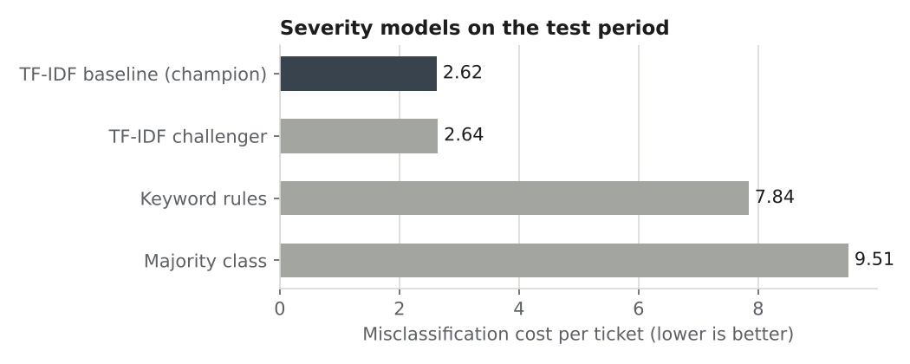
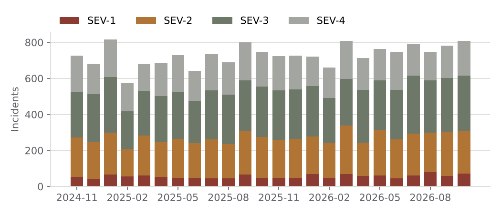
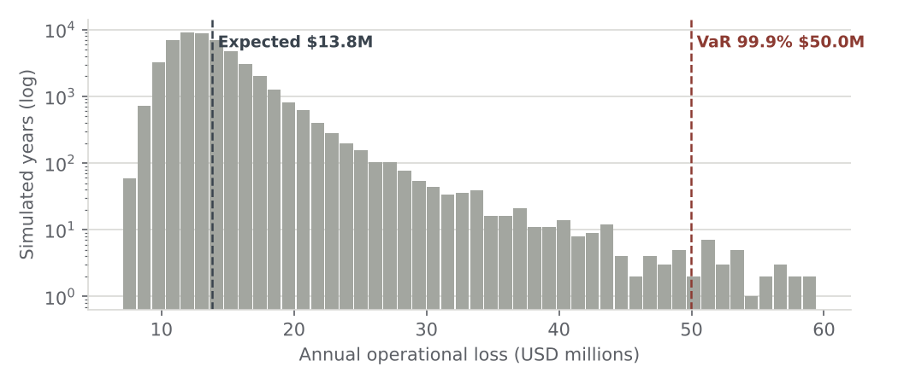
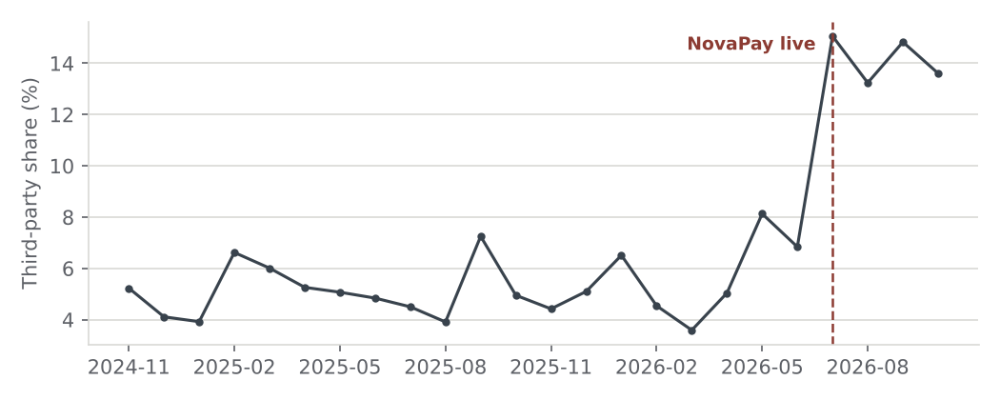

# Incident Triage Agent

An operational risk project: an AI agent that triages IT incident tickets, finds recurring root causes and quantifies operational loss, with human review built into every decision.

**Live demo:** https://aishwaryapurohit15.github.io/incident-triage-agent/

The agent reads each new incident ticket, suggests its severity and owning team, links it to similar past incidents and routes it to the right level of human review. It can read and suggest, but it cannot close a ticket, change severity or reassign work. Those actions stay with people.

> All data in this repository is synthetic and generated by the project code. It is built to behave like a real IT service management export, and it does not describe any real organization.

## Results at a glance

Measured on six months of tickets (May to October 2026) that were never used for training or model selection.

| Measure | Result |
|---|---|
| Triage effort saved | 43% (about 200 coordinator hours over six months) |
| SEV-1 incidents kept off the fast path | 99.7% (one ticket of about 376 reached it) |
| Fast-path tickets that were really SEV-1 or SEV-2 | 2.6% (limit: 3%) |
| Owner suggestions matching the team that worked the ticket | 93.0% (keyword rules: 75.3%) |
| Misclassification cost per ticket | 2.62 (keyword rules: 7.84) |
| Duplicates found that staff had missed | 46 of 91 |
| Simulated annual operational loss | $13.8M expected; $50.0M at the 99.9% level |


### 1. Business decision and risk outcome

A mid-sized bank's service desk logs about 730 IT incidents a month. For each one, a triage coordinator decides:

- **Severity** (SEV-1 to SEV-4), which sets the resolution target: 4, 8, 24 or 72 hours.
- **Owner**, one of eight resolver teams.
- **Duplicate or repeat**, which links the ticket to an existing incident or a recurring root cause.

The **risk outcome** is under-triage: a serious incident treated as minor. It delays the response, breaches resolution targets and lets customer-facing losses grow. Over-triage is cheaper but pulls senior engineers away from real outages. Both are scored with a cost matrix in `src/triage/config.py` that makes under-triaging a SEV-1 incident as SEV-4 100 times more expensive than a correct call. Incidents are mapped to Basel II operational risk event types.

### 2. Data sources, grain, time window and quality issues

| Item | Detail |
|---|---|
| Sources | Incident tickets, resolution records, loss events and change records |
| Grain | One row per incident ticket |
| Window | November 1, 2024 to October 31, 2026 (24 months, 17,584 raw rows) |
| Training | November 2024 to April 2026, with February to April 2026 held back for model selection |
| Test | May to October 2026 (4,637 tickets), never used for any choice |

A separate ground-truth file (`data/raw/ground_truth.csv`) holds each ticket's true root cause, true severity and true duplicate link. The models never see it; it is used only for scoring.

Quality issues planted in the export and how each is handled (`src/triage/quality.py`):

| Issue | Rows | Handling |
|---|---|---|
| Inconsistent category labels ("NW", "Netwrk", "network") | 46 labels | Mapped to 10 controlled categories |
| Exact duplicate rows | 87 | Removed |
| Duplicate reports of the same outage | 711 marked by staff | Agent suggests links |
| Missing resolution notes | 3,867 (22%) | Not used as model inputs |
| Unassigned tickets | 527 | Excluded from owner training and scoring |
| Resolved before opened | 363 | Resolution time set to unknown |
| Never resolved | 176 | Excluded from resolution-time statistics |
| Vague descriptions ("Not working.") | 968 (5.5%) | Kept; low confidence sends them to full review |
| Typos and abbreviations | Widespread | Text normalization |
| Severity recorded with errors | About 9% | Measured against the hidden true severity |

A time-based split is used instead of a random one, because a random split would let the model learn about an outage from tickets filed after it. Testing on later months also exposes the model to real drift: a new payments vendor, NovaPay, goes live in July 2026.

### 3. Analytical methods and trade-offs

**Severity and owner classification** (`src/triage/models.py`)

| Severity method | Accuracy | SEV-1 recall | Under-triage | Cost per ticket |
|---|---|---|---|---|
| Majority class | 38.2% | 0% | 38.3% | 9.51 |
| Keyword rules | 42.8% | 0% | 35.2% | 7.84 |
| **TF-IDF + logistic regression (champion)** | **65.9%** | **59%** | **14.6%** | **2.62** |
| TF-IDF + character n-grams + service metadata | 65.4% | 57% | 15.0% | 2.64 |

- The champion was chosen on the validation months by the lowest cost per ticket. The richer challenger added complexity without improving cost or SEV-1 recall, so the simpler model won.
- Against the hidden true severity the champion reaches 69.4%, so part of the remaining error is noise in the recorded labels.
- Severity is hard to read from text alone. That is why the review policy (step 5) escalates any ticket with a meaningful chance of SEV-1 instead of trusting the top prediction.
- The owner model reaches 93.0% agreement with the recorded team. Most disagreements are tickets staff sent to the wrong queue. In this synthetic data the owner follows directly from the root cause, so real-world owner accuracy would be lower.



**LLM classifier** (`src/triage/llm.py`). The LLM adapter uses the same output contract, retries on schema errors and fails closed. It handles unseen wording and writes a reason, but it costs money per ticket, adds latency and is harder to audit. Run `scripts/run_llm_eval.py` with an `ANTHROPIC_API_KEY` to score it on a sample of test tickets. No LLM results are included, because none were run for this build.

**Duplicate detection** (`src/triage/similarity.py`). Each ticket is compared with earlier tickets on the same service within six hours, using a TF-IDF vectorizer that drops common impact phrases so that matches depend on symptoms. At the threshold chosen on validation, precision is 41% and recall is 42%. Staff marked 70% of true duplicates; the agent found 46 of the 91 they missed.

**Recurring-issue clustering.** Ticket text is reduced with latent semantic analysis and grouped with k-means. The number of clusters (32) was chosen by silhouette score. Against the hidden root causes the clusters reach a normalized mutual information of 0.87 and an adjusted Rand index of 0.59. Clusters are ranked by loss, repeat rate and trend; vendor API outages grow fastest after the NovaPay launch.

**Operational risk analytics** (`src/triage/risk.py`)

- **Volume control chart:** a Poisson limit around the trailing median flags 13 abnormal days, including 6 of the 10 planted major outages.
- **Resolution performance:** SEV-1 incidents breach their 4-hour target 15.3% of the time; Third-Party Vendor Management has the highest breach rate.
- **Loss distribution approach:** Poisson frequency and lognormal severity per Basel event type, simulated over 50,000 years. Expected annual loss is $13.8M, VaR at 99.9% is $50.0M and expected shortfall at 99.9% is $69.4M. The simulated expected loss is close to the observed $12.8M a year, and Kolmogorov-Smirnov tests do not reject the lognormal fits.
- **Change risk:** 20% of incidents follow a change and carry 23% of the loss.
- **Drift:** the third-party share rises from 5.3% to 14.2% after NovaPay goes live.




### 4. Agent workflow, tools, schemas and permission boundaries

`src/triage/agent.py` defines the tools, their JSON schemas and the permission layer.

```
New ticket -> classify_severity -> suggest_owner -> find_similar_incidents
           -> routing policy -> submit_suggestion -> fast path | full review | escalate now -> human decides
```

| Tool | Permission | Agent access |
|---|---|---|
| `classify_severity` | read | Allowed |
| `suggest_owner` | read | Allowed |
| `find_similar_incidents` | read | Allowed |
| `submit_suggestion` | suggest | Allowed |
| `set_severity` | write | Refused |
| `close_ticket` | write | Refused |
| `reassign_ticket` | write | Refused |

Write tools are registered on purpose so that any attempt to use them is refused with `PermissionDenied` and recorded in the audit log, instead of being silently absent. Every suggestion must match `SUGGESTION_SCHEMA` before it is queued for review.

### 5. Validation, monitoring, human review and rollback

**Human review policy** (thresholds set on validation data):

- **Escalate now** when the chance of SEV-1 is at least 30%.
- **Full review** for any suggested SEV-1 or SEV-2, and whenever the model is unsure.
- **Fast path** only when the chance of SEV-1 or SEV-2 is at most 10% and owner confidence is at least 85%. A coordinator still confirms with one click.

On the test period, 24% of tickets took the fast path, 60% went to full review and 16% were escalated.

**Validation:** time-based back-test, cost-weighted scoring, calibration (expected calibration error of 0.046), a label-noise check, benchmarks against keyword rules and a majority-class baseline, and unit tests.

**Monitoring:** monthly override rates and population stability index (PSI) on the category mix and the prediction mix. Overrides more than 3 points above the validation rate trigger a watch and more than 5 points an alert; PSI above 0.10 triggers a watch and above 0.25 an alert. The category-mix PSI crossed the watch limit in three of the four months after the NovaPay launch.



**Rollback:** a kill switch in `models/registry.json` stops all suggestions and returns tickets to manual triage. The registry names a fallback (keyword rules or the previous model), and the routing policy is versioned separately from the model. Because the agent never writes to the system of record, a rollback never requires repairing tickets.

### 6. Success metrics and implementation plan

| Metric | Result | Target |
|---|---|---|
| SEV-1 incidents kept off the fast path | 99.7% | 100% |
| Under-triage rate | 14.6% | Below 15% |
| Cost per ticket against keyword rules | 2.62 vs 7.84 | At least 50% lower |
| Owner suggestion accuracy | 93.0% | Above 90% |
| Triage effort saved | 43% | Above 30% |
| Duplicates found that staff missed | 46 of 91 | Above 40% |
| SEV-1 SLA breach rate (baseline) | 15.3% | Below 10% |

| Phase | Weeks | Work | Gate |
|---|---|---|---|
| 1. Data and baseline | 1 to 3 | Read-only connection, cleaning pipeline, cost matrix, back-test | Model risk sign-off |
| 2. Shadow mode | 4 to 7 | Suggestions logged but hidden; weekly comparison with human decisions | No SEV-1 on the fast path for four weeks |
| 3. Assisted pilot | 8 to 11 | One shift sees suggestions with accept and override buttons | Targets met and coordinators support rollout |
| 4. Rollout and run | 12 onward | All shifts, monthly monitoring, LLM challenger on hard tickets | Quarterly model review |

## Repository layout

```
src/triage/
  config.py        constants: severities, SLA targets, teams, services, cost matrix
  generate.py      synthetic incident generator with planted quality issues
  quality.py       data-quality audit, cleaning and text normalization
  models.py        keyword rules, TF-IDF models and evaluation metrics
  similarity.py    duplicate detection and recurring-issue clustering
  risk.py          control chart, SLA, concentration, loss distribution, PSI
  agent.py         tools, schemas, permissions, routing policy and audit log
  llm.py           LLM classifier adapter (optional)
  pipeline.py      end-to-end run that writes reports and website data
scripts/           figures, command-line triage and LLM evaluation
tests/             unit tests
docs/              demo website (GitHub Pages)
data/              raw and cleaned incident data
reports/           metrics.json with every number on the website
models/            model registry with the kill switch
```

## Run it yourself

Requires Python 3.10 or later.

```bash
pip install -r requirements.txt
make all          # generate data, run the pipeline, draw figures, run tests
make serve        # open http://localhost:8000 to view the website
```

Triage a single ticket from the command line:

```bash
PYTHONPATH=src python scripts/triage_ticket.py \
  --service "Payments Gateway" \
  --short "Card payments failing" \
  --description "About 40% of transactions are failing. Many users are affected."
```

The website's live demo runs the TF-IDF model in the browser from `docs/data/web_model.js`; nothing is sent to a server.

## Limitations

- The data is synthetic. Real tickets are messier, and severity depends on context the text may not contain.
- Owner accuracy is optimistic because the synthetic owner follows directly from the root cause.
- The LLM challenger is implemented but not scored in this build.
- Time saved rests on assumed handling times (6 minutes manual, 1.5 minutes to confirm, 4 minutes for a full review), which a pilot should measure.

## License

MIT. See `LICENSE`.
